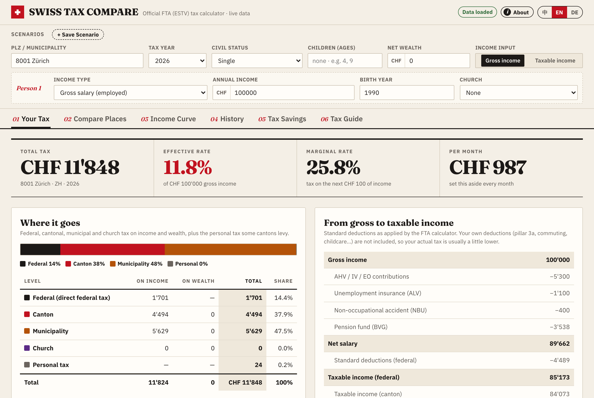
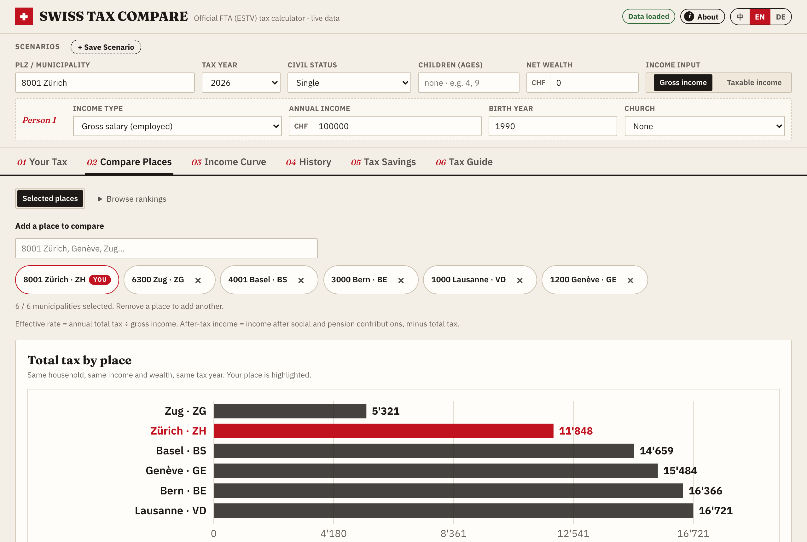

# Swiss Tax Compare（瑞士所得税与财富税计算比价）

[English](README.md) · **中文**

基于瑞士联邦税务管理局（ESTV / FTA）官方计算器接口，查询与对比全瑞士 2'110 个市镇的所得税与财富税：看清每一分税款的去向、横向比较不同居住地的税后收入，并估算第三支柱（3a）与养老金（BVG）补缴的节税额。

**线上地址：** https://swiss-tax-compare.pages.dev（备用镜像：https://swiss-tax-compare.vercel.app）· **姊妹项目：** [Swiss Insurance Compare（瑞士基础医保比价）](https://swiss-insurance-compare.pages.dev)（[GitHub](https://github.com/maxing-labs/swiss-insurance-compare)）





Swiss Tax Compare 是个人独立项目，与瑞士联邦税务管理局（ESTV / FTA）无关。所有数据均实时取自官方计算器 [swisstaxcalculator.estv.admin.ch](https://swisstaxcalculator.estv.admin.ch) 后端接口；结果基于法定标准扣除估算，仅供参考，不构成税务建议。

## 功能概览

- 支持输入**毛收入**（由 ESTV 计算器自动计算社保、养老金及标准扣除）或**应税所得**、婚姻状况、子女年龄、教会税、净财富及纳税年度（2010–2026）。
- **税负概览（01 Your Tax）：** 总税额、有效税率、边际税率、月均预留金额，联邦 / 州 / 市镇 / 教会四级税负占比，以及从毛收入到联邦与州应税所得的完整扣除明细。
- **地点比较（02 Compare Places）：** 默认固定当前所在地，最多可自选 6 个市镇同屏对比年度总税额、有效税率、税后收入及与当前所在地的差额（所选地点随浏览器与分享链接保存）。同时保留全瑞士 2'110 个市镇、单州或 26 个州府的完整排名与 CSV 导出。
- **收入曲线（03 Income Curve）：** 展示不同收入水平下的有效税率与边际税率曲线，并高亮当前收入位置。
- **历年走势（04 History）：** 同一家庭配置在 2010–2026 年间的年度税额变化。
- **节税测算（05 Tax Savings）：** 估算第三支柱（Pillar 3a）缴款与第二支柱（BVG）补缴在当前所在地及 26 个州府能省下多少税款。
- **税务指南（06 Tax Guide）：** 用 7 张卡片梳理瑞士税务核心机制。
- **方案保存与分享：** 支持在浏览器中保存、切换和对比多套家庭方案；支持英文、德文、中文界面与 URL 分享；无账号、无追踪。

后续迭代计划见 [`.agents/docs/roadmap.md`](.agents/docs/roadmap.md)。

## 本地运行与测试

项目**零外部依赖**：后端仅使用 Python 标准库，前端为原生 ES 模块（无构建步骤）。

```sh
python3 server.py                  # 启动本地服务：http://127.0.0.1:8766
python3 -m unittest                # 后端离线单元测试（使用 tests/fixtures/ 中的上游快照）
node --test 'tests/js/*.test.mjs'  # 前端单元测试（需 Node >= 22）
```

生产环境无服务器部署于 Cloudflare Pages（`functions/api/[[path]].js` + `static/_headers`）与 Vercel（`vercel.json` 将 `/api/*` 路由至 `api/index.py`、其余静态资源路由至 `static/`）。

## 协作方式：由 Coding Agents 构建

与姊妹项目 [Swiss Insurance Compare](https://github.com/maxing-labs/swiss-insurance-compare)（[线上](https://swiss-insurance-compare.pages.dev)，瑞士医保比价）一样，本仓库迄今为止的每一次提交均由 AI 编程代理完成。[`AGENTS.md`](AGENTS.md) 是每个 Agent 首先阅读的项目规范，[`.agents/docs/`](.agents/docs/) 存放每次会话的工作记录与路线图。

## 许可证

[MIT](LICENSE)。自托管字体 Fraunces 与 IBM Plex Sans 基于 SIL Open Font License 分发，详见 `static/fonts/`。
