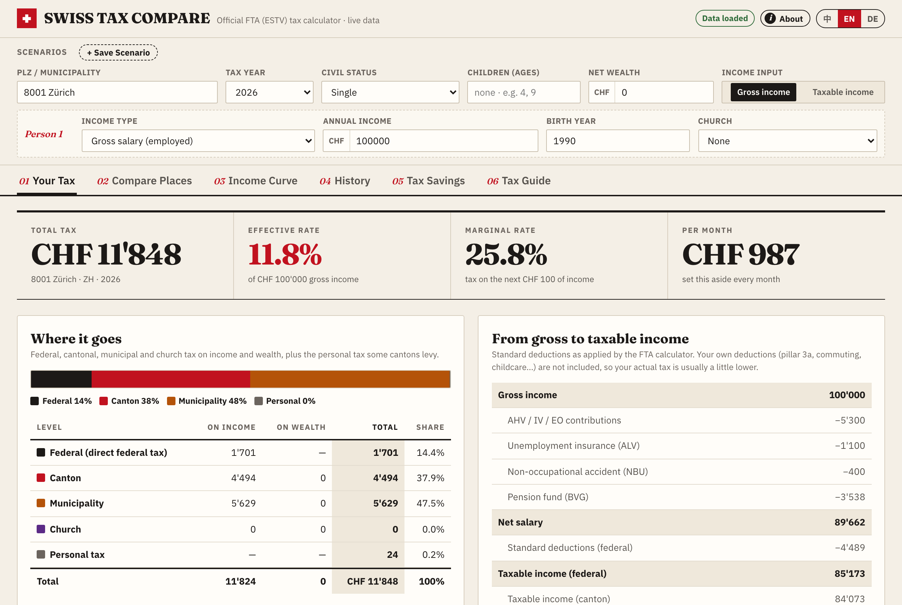
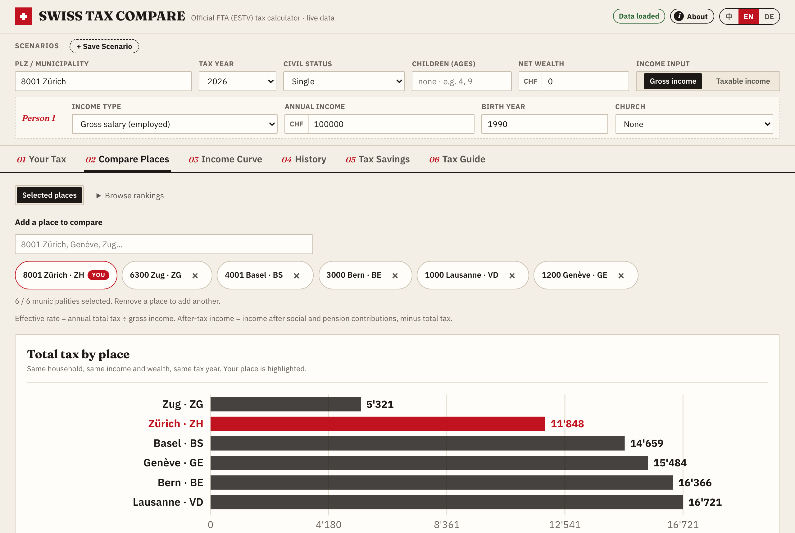

# Swiss Tax Compare

**English** · [中文](README-zh.md)

Income and wealth tax for every Swiss municipality, from the official calculator of the Swiss Federal Tax Administration (FTA / ESTV): see where your money goes, and compare a few chosen places for the same household, with rankings across all 2'110 municipalities also available.

**Live:** https://swiss-tax-compare.vercel.app · **Sister project:** [Swiss Insurance Compare](https://swiss-insurance-compare.vercel.app) ([GitHub](https://github.com/maxing-labs/swiss-insurance-compare))





Swiss Tax Compare is an independent hobby project and is not affiliated with the FTA. Every figure comes live from the engine behind [swisstaxcalculator.estv.admin.ch](https://swisstaxcalculator.estv.admin.ch); results are estimates with standard deductions and are not tax advice.

## What it does

- Enter gross income (standard deductions applied by the FTA calculator) or taxable income, civil status, children, church, wealth and tax year (2010–2026).
- **Your Tax:** total, effective and marginal rate, the split between federal, cantonal, municipal and church tax, and the path from gross to taxable income.
- **Compare Places:** choose up to six municipalities, including your current place, and compare annual tax, effective rate, after-tax income and the difference to your place. Selected places stay in your browser and shareable URL. Rankings for all Switzerland, one canton or the 26 capitals, with CSV export, remain available.
- **Income Curve:** effective and marginal tax rates by income, with your current income highlighted.
- **History:** annual tax totals from 2010 to 2026 for the same household, with changes between years.
- **Saved scenarios:** save, switch and compare household setups in your browser.
- **Tax Savings:** estimate what pillar 3a contributions and BVG buy-ins save, here and in the 26 cantonal capitals.
- **Tax Guide:** the Swiss tax system in seven cards.
- English, German and Chinese UI; shareable URLs. Inputs and saved scenarios stay in your browser. No accounts, no tracking.

Tabs: Your Tax, Compare Places, Income Curve, History, Tax Savings (what a pillar 3a contribution and a BVG buy-in save, here and in the 26 cantonal capitals), Tax Guide.

See [`.agents/docs/roadmap.md`](.agents/docs/roadmap.md) for current follow-up work.

## Running it

No dependencies: the backend is Python standard library only, the frontend is plain ES modules with no build step.

```sh
python3 server.py                  # http://127.0.0.1:8766
python3 -m unittest                # backend tests, offline, against the snapshots in tests/fixtures/
node --test 'tests/js/*.test.mjs'  # frontend unit tests (Node >= 22)
```

Production runs on Vercel: `vercel.json` routes `/api/*` to `api/index.py` and everything else to `static/`.

## Built with coding agents

Like its sibling [Swiss Insurance Compare](https://github.com/maxing-labs/swiss-insurance-compare) ([live](https://swiss-insurance-compare.vercel.app), health insurance premiums), every commit so far was written by an AI coding agent. [`AGENTS.md`](AGENTS.md) is the brief every agent reads first; [`.agents/docs/`](.agents/docs/) holds one record per session and the roadmap. The notes are in Chinese, the language the maintainer uses with the agents.

## License

[MIT](LICENSE). The self-hosted fonts Fraunces and IBM Plex Sans are distributed under the SIL Open Font License; see `static/fonts/`.
